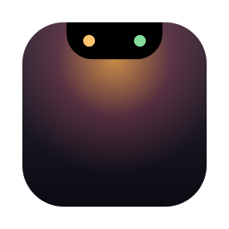

<p align="center">
  
</p>

<h1 align="center">Burrow</h1>
<p align="center"><b>Çentiğin içindeki küçük yuva.</b><br>MacBook çentiğini canlı bir Dynamic Island'a çeviren, yerel, hafif ve ücretsiz macOS uygulaması.</p>

---

## Kurulum (tek komut)

```bash
curl -fsSL https://raw.githubusercontent.com/__GITHUB_REPO__/main/scripts/install.sh | bash
```

Betik son sürümü indirir, **SHA-256** ve **kod imzası** doğrulamalarını yapar, `/Applications`'a kurar ve açar.
Sonraki güncellemeler **uygulama içinden otomatik** gelir; bir şey yapmana gerek yok.

> Gereksinim: macOS 14 Sonoma veya üstü. Çentiksiz Mac'lerde ve harici ekranlarda sanal çentik çizilir.

## Özellikler

| | Özellik | Açıklama |
|---|---|---|
| 🎵 | **Çalan müzik** | Kapak, ilerleme çubuğu (sürükleyerek atla), oynat/duraklat/ileri/geri. Müzik ve Spotify. |
| 🌈 | **Kapak rengi ışıması** | Çalan şarkının kapak rengi çentiğe yayılır, ekolayzer çubukları o renkte dalgalanır. |
| ✨ | **Canlı etkinlikler** | Kapalı çentiğin iki yanında: çalan şarkı, şarj takıldı, düşük pil, ses/parlaklık, Bluetooth cihaz bağlandı. |
| 👆 | **Kaydırma hareketleri** | İki parmakla yatay kaydır → sonraki/önceki şarkı. Aşağı kaydır → aç, yukarı → kapat. |
| 🔊 | **Yeni HUD** | macOS'un ortadaki ses/parlaklık göstergesi yerine çentikte zarif bir çubuk (isteğe bağlı). |
| 📅 | **Takvim** | Bugün ve yarının yaklaşan etkinlikleri. |
| 🗂 | **Dosya rafı** | Dosyayı çentiğe sürükle-bırak, sonra istediğin yere sürükle. AirDrop ile tek tıkla paylaş. |
| 🪞 | **Kamera aynası** | Görüntülü görüşme öncesi hızlı kontrol. Çentik kapanınca kamera kapanır. |
| 🔋 | **Pil** | Açık çentikte yüzde ve durum. |
| ⚡️ | **Hızlı ve hafif** | Yerel Swift. Oynatıcı yoksa yoklama yok; pil, ses ve Bluetooth tamamen olay tabanlı. |
| 🔄 | **Otomatik güncelleme** | `main` dalına her push yeni sürüm yayınlar; uygulama saatlik denetler, imzayı doğrular ve kurar. |

## İzinler

Her izin yalnızca ilgili özellik kullanıldığında istenir ve her özellik ayarlardan kapatılabilir.

| İzin | Neden |
|---|---|
| Otomasyon (Müzik / Spotify) | Çalan şarkıyı okumak ve kontrol etmek |
| Takvimler | Yaklaşan etkinlikleri göstermek |
| Kamera | Ayna (yalnızca sen açınca) |
| Bluetooth | Cihaz bağlandı bildirimi |
| Erişilebilirlik | *Sadece* "Sistem HUD'unu değiştir" açıksa ses/parlaklık tuşlarını yakalamak için (varsayılan kapalı) |

## Güvenlik

- Güncellemeler **ed25519 (EdDSA)** ile imzalanır; imzası tutmayan paket kurulmaz. Özel anahtar yalnızca GitHub Secrets'ta.
- Kurulum betiği SHA-256 ve `codesign --verify --strict` doğrulaması yapar.
- Ağ erişimi: yalnızca GitHub (güncelleme) ve Spotify kapak CDN'i (https, izinli alan adı listesi).
- Veri toplama / analitik **yok**.
- Uygulama Apple Developer ID ile noter onaylı değildir (ücretli hesap gerektirir). Bu yüzden tarayıcıdan zip indirip
  açarsan macOS uyarı verir; kurulum betiği bu adımı güvenli biçimde halleder.

## Geliştirme

```bash
brew install xcodegen
xcodegen generate                 # Burrow.xcodeproj üretir
scripts/build-local.sh            # derle, imzala, /Applications'a kur, aç
xcodebuild test -project Burrow.xcodeproj -scheme Burrow -destination 'platform=macOS'
```

İlk kez GitHub'a bağlamak (repo + güncelleme anahtarları + imza sertifikası):

```bash
gh auth login
scripts/setup-github.sh           # depo adı varsayılan: burrow
```

Mimari: [`docs/MIMARI.md`](docs/MIMARI.md) · Kararlar: [`docs/kararlar/`](docs/kararlar/) · Durum: [`DURUM.md`](DURUM.md)

## İlham

[Alcove](https://tryalcove.com) ve [Boring Notch](https://boringnotch.com). Burrow bağımsız, sıfırdan yazılmış bir projedir;
iki projeyle de bağlantısı yoktur ve kodlarını içermez.
