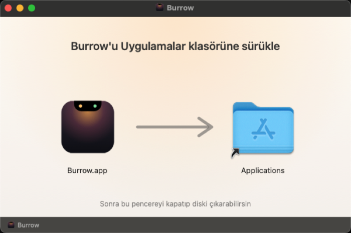

<p align="center">
  
</p>

<h1 align="center">Burrow</h1>
<p align="center"><b>Çentiğin içindeki küçük yuva.</b><br>MacBook çentiğini canlı bir Dynamic Island'a çeviren, yerel, hafif ve ücretsiz macOS uygulaması.</p>

---

## Kurulum

### Seçenek 1: Sürükle-bırak (klasik)

1. **[Burrow.dmg'yi indir](https://github.com/ismsahin/Burrow-Notch/releases/latest/download/Burrow.dmg)** ve aç.
2. Açılan pencerede **Burrow** simgesini **Applications (Uygulamalar)** klasörüne sürükle.
3. Pencereyi kapat, masaüstündeki/Finder kenar çubuğundaki **Burrow** diskini çıkar (⏏).
4. Uygulamalar'dan Burrow'u aç. **İlk açılışta** macOS "doğrulanamadı" uyarısı verir (Apple'a ücretli geliştirici kaydı
   yapılmadığı için): **Sistem Ayarları › Gizlilik ve Güvenlik** › en altta **"Yine de Aç"** → onayla. Bir kez yapılır.

<p align="center"></p>

### Seçenek 2: Tek komut (uyarısız)

```bash
curl -fsSL https://raw.githubusercontent.com/ismsahin/Burrow-Notch/main/scripts/install.sh | bash
```

Betik son sürümü indirir, **SHA-256**, **kod imzası** ve **sabitlenmiş sertifika** doğrulamalarını yapar,
`/Applications`'a kurar ve açar. Terminal ile indirildiği için Gatekeeper uyarısı çıkmaz.

İki yöntemde de sonraki güncellemeler **uygulama içinden otomatik** gelir; bir şey yapmana gerek yok.

> Gereksinim: macOS 14 Sonoma veya üstü. Çentiksiz Mac'lerde ve harici ekranlarda sanal çentik çizilir.

## Özellikler

| | Özellik | Açıklama |
|---|---|---|
| 🎵 | **Çalan müzik** | YouTube/Chrome/Safari dahil her oynatıcı: kapak, ilerleme çubuğu (sürükleyerek atla), oynat/duraklat/ileri/geri. |
| 🌈 | **Kapak rengi ışıması** | Çalan şarkının kapak rengi çentiğe yayılır, ekolayzer çubukları o renkte dalgalanır. |
| ✨ | **Canlı etkinlikler** | Çalan şarkı, indirme ilerlemesi, yaklaşan toplantı, zamanlayıcı; şarj, düşük pil, ses/parlaklık, cihaz bağlandı. |
| 🔀 | **Çoklu etkinlik** | Aynı anda birkaçı varsa çentiğin üzerinde iki parmakla sağa/sola (fare tekerleğiyle yukarı/aşağı) kaydırarak geç. Öncelikli olanı sen seç. |
| 🎧 | **Kulaklık pili** | AirPods bağlanınca sol/sağ/kutu pil düzeyi; açık çentikte kulaklık simgesiyle. |
| ⏱ | **Zamanlayıcı** | Süre sekmesinden 1–45 dk ya da özel süre; kalan süre kapalı çentikte, bitince ses. |
| 💊 | **Dynamic Island** | Çentiksiz ekranlarda (harici monitör) menü çubuğunda yüzen hap biçimi — isteğe bağlı. |
| 🧲 | **Yaklaşınca büyü** | İmleç yaklaştıkça çentik yumuşakça kabarır; üzerinde bekleyince ya da tıklayınca açılır (ayarlanabilir). |
| 👆 | **Kaydırma hareketleri** | Açık çentikte yatay → şarkı değiştir. Aşağı kaydır → aç, yukarı → kapat. |
| 🔊 | **Yeni HUD** | macOS'un ortadaki ses/parlaklık göstergesi yerine çentikte zarif bir çubuk (isteğe bağlı). |
| 📅 | **Takvim** | Bugün ve yarının yaklaşan etkinlikleri. |
| 🔔 | **Bildirimler** | Tüm uygulama bildirimleri önce büyük kart, sonra çentikte simge + sayı (Tam Disk Erişimi ile). |
| 📋 | **Pano geçmişi** | Yazı / bağlantı / medya kategorileri, yıldızla, filtrele, ara; tıkla → tekrar kopyala. |
| ⏰ | **Alarm ve geri sayım** | Saat alarmları (bir kez / her gün) ve zamanlayıcı. |
| ✅ | **Anımsatıcılar** | Tamamlanmamış anımsatıcılar; tıkla → tamamlandı. |
| 🗂 | **Dosya rafı** | Dosyayı çentiğe sürükle-bırak, sonra istediğin yere sürükle. AirDrop ile tek tıkla paylaş. |
| 🪞 | **Kamera aynası** | Görüntülü görüşme öncesi hızlı kontrol. Çentik kapanınca kamera kapanır. |
| 🔋 | **Pil** | Açık çentikte yüzde ve durum. |
| ⚡️ | **Hızlı ve hafif** | Yerel Swift. Oynatıcı yoksa yoklama yok; pil, ses ve Bluetooth tamamen olay tabanlı. |
| 🔄 | **Otomatik güncelleme** | `main` dalına her push yeni sürüm yayınlar; uygulama saatlik denetler, imzayı doğrular ve kurar. |

## İzinler

Her izin yalnızca ilgili özellik kullanıldığında istenir ve her özellik ayarlardan kapatılabilir.

| İzin | Neden |
|---|---|
| Otomasyon (Müzik / Spotify) | Çalan şarkıyı okumak ve kontrol etmek |
| Takvimler | Yaklaşan etkinlikleri göstermek |
| Kamera | Ayna (yalnızca sen açınca) |
| Bluetooth | Cihaz bağlandı bildirimi |
| Erişilebilirlik | *Sadece* "Sistem HUD'unu değiştir" açıksa ses/parlaklık tuşlarını yakalamak için (varsayılan kapalı) |
| Anımsatıcılar | Anımsatıcılar sekmesini ilk açtığında |
| Tam Disk Erişimi | *Sadece* bildirimleri çentikte görmek istersen; Bildirim Merkezi veritabanı salt okunur okunur, hiçbir yere gönderilmez |

## Güvenlik

- Güncellemeler **ed25519 (EdDSA)** ile imzalanır; imzası tutmayan paket kurulmaz. Özel anahtar yalnızca GitHub Secrets'ta.
- Kurulum betiği SHA-256 ve `codesign --verify --strict` doğrulaması yapar.
- Ağ erişimi: yalnızca GitHub (güncelleme) ve Spotify kapak CDN'i (https, izinli alan adı listesi).
- Veri toplama / analitik **yok**.
- Uygulama Apple Developer ID ile noter onaylı değildir (ücretli hesap gerektirir). Bu yüzden DMG ile kurulumda ilk açılışta
  macOS bir kez uyarı verir ("Yine de Aç"). Kurulum betiği bu adımı gerektirmez.

## Geliştirme

```bash
brew install xcodegen
xcodegen generate                 # Burrow.xcodeproj üretir
scripts/build-local.sh            # derle, imzala, /Applications'a kur, aç
xcodebuild test -project Burrow.xcodeproj -scheme Burrow -destination 'platform=macOS'
```

İlk kez GitHub'a bağlamak (repo + güncelleme anahtarları + imza sertifikası):

```bash
gh auth login
scripts/setup-github.sh           # depo adı varsayılan: burrow
```

Mimari: [`docs/MIMARI.md`](docs/MIMARI.md) · Kararlar: [`docs/kararlar/`](docs/kararlar/) · Durum: [`DURUM.md`](DURUM.md)

## Üçüncü taraf

- [Sparkle](https://sparkle-project.org) — otomatik güncelleme (MIT)
- [mediaremote-adapter](https://github.com/ungive/mediaremote-adapter) — sistem geneli "şu an çalan" (BSD-3, `Vendor/`)

## İlham

[Alcove](https://tryalcove.com) ve [Boring Notch](https://boringnotch.com). Burrow bağımsız, sıfırdan yazılmış bir projedir;
iki projeyle de bağlantısı yoktur ve kodlarını içermez.
